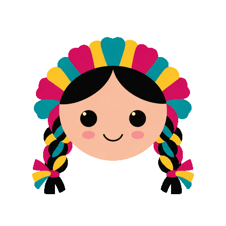
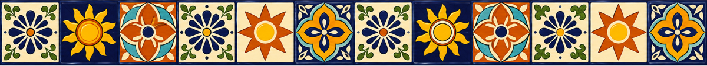
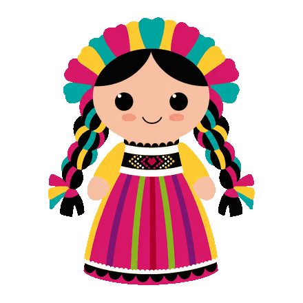

# Hola, soy Lizeth Bello

**Frontend Development · Data Analysis · UX/UI**

Estudiante de Ingeniería de Software en la Universidad Veracruzana, México.
Me gusta entender a las personas y el problema antes de construir una solución.

 **Me interesa:** crear interfaces claras, explorar datos y diseñar experiencias útiles. 
 **Estoy aprendiendo:** frontend y diseño de experiencias de usuario. 
 **Mi forma de trabajar:** entender → definir → diseñar → construir → aprender.

 

## Tecnologías y herramientas

**Frontend · en aprendizaje**

   

**Análisis de datos**

    

**Otras herramientas de mis proyectos académicos**

   

Las etiquetas muestran herramientas que uso o estoy aprendiendo; no representan niveles de dominio.

## Proyectos seleccionados

 **[Musa · Books & Music](https://github.com/lizethbellop/books-music-platform)**  
Plataforma con frontend Flutter, catálogos, perfiles y selección de preferencias. **En desarrollo.**

 **[Safe-Steps](https://github.com/lizethbellop/Safe-Steps)**  
Interfaz React con navegación, registro, selección de perfiles y acceso a juegos. **Código disponible; capturas y alcance por documentar.**

 **[NFL Data Analysis](https://github.com/lizethbellop/NFLDataAnalysis)**  
Preparación e integración de datos con pandas y experimentación con Random Forest. **Experimento académico; reproducibilidad y validación temporal pendientes.**

 **[Gestión de Prácticas Profesionales](https://github.com/lizethbellop/Professional-Practices-Project)**  
Aplicación Java para coordinadores, estudiantes y docentes. Participé en requisitos, UML e implementación de funcionalidades. **Proyecto académico.**

Las funciones describen los repositorios; no implican autoría individual de todos sus componentes.

## Bitácora Culinaria · Caso de negocio

Un plan de negocio que parte de una idea y la convierte en una propuesta estructurada.

 Propuesta de valor y modelo de operación. 
 Diseño de procesos e indicadores clave (KPI). 
 Estructura de costos y estimación del punto de equilibrio.

**Trabajo documentado en mi CV.** El caso completo con decisiones, supuestos y aprendizajes está **por publicar**. Es un proyecto de planeación, sin presentarlo como aplicación implementada ni negocio en operación.

## Un poquito más de mí

 Me interesan la cultura, los deportes y los proyectos con beneficio social. 
 He participado en levantamiento de requisitos y diseño con UML. 
 Certificación: Google Foundations of User Experience (UX) Design, 2025.

## Conectemos

 <b>¡Gracias por visitar mi rincón de GitHub!</b>

